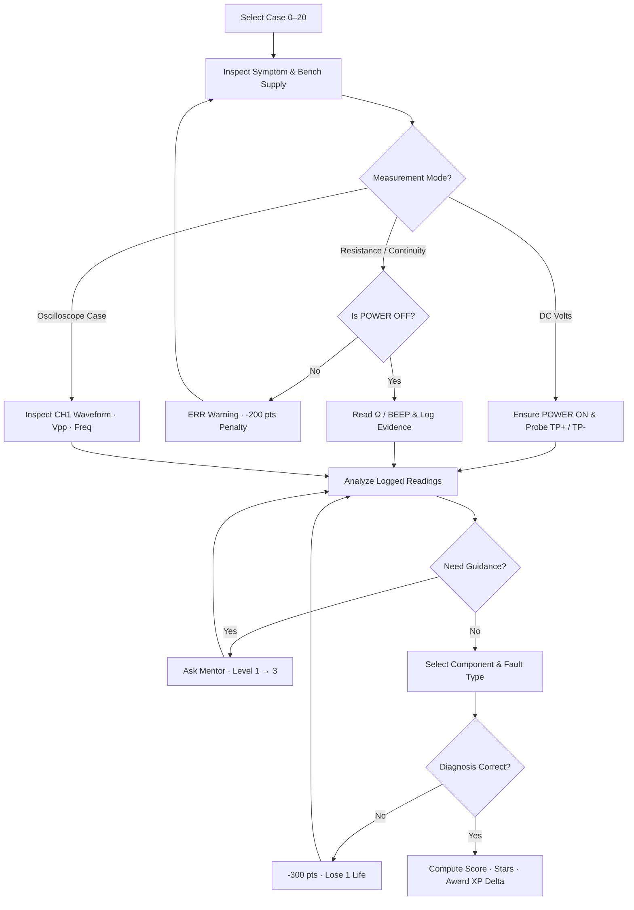

&lt;div align=&quot;center&quot;&gt;

# ⚡ CIRCUIT SLEUTH – The Electronics Detective

### *"Every circuit has a secret. Find the fault. Prove it with measurements."*

[](https://circuit-sleuth.embarko.app/)
[](#technology-stack)
[](#core-features)
[](#automated-testing)
[](#installation--local-execution)

**An interactive, physics-driven circuit troubleshooting simulator powered by a real Modified Nodal Analysis (MNA) solver, virtual DMM, and live oscilloscope.**

[🚀 Play Live](https://circuit-sleuth.embarko.app/) · [🔬 Virtual Lab](#virtual-laboratory) · [🧭 How to Play](#how-to-play) · [🏗️ Architecture](#project-folder-architecture) · [🧪 Tests](#automated-testing)

&lt;/div&gt;

---

## 📑 Table of Contents

- [Project Introduction](#project-introduction)
- [Problem Statement & Motivation](#problem-statement--motivation)
- [What Makes CIRCUIT SLEUTH Different](#what-makes-circuit-sleuth-different)
- [Core Features](#core-features)
- [How to Play](#how-to-play)
- [Virtual Laboratory](#virtual-laboratory)
- [Investigation Workflow](#investigation-workflow)
- [Visual Identity & Design System](#visual-identity--design-system)
- [Technology Stack](#technology-stack)
- [Project Folder Architecture](#project-folder-architecture)
- [Installation & Local Execution](#installation--local-execution)
- [Automated Testing](#automated-testing)
- [Deployment & Live Application](#deployment--live-application)
- [Embarko Student Challenge](#embarko-student-challenge)
- [Future Development Possibilities](#future-development-possibilities)
- [Project Creator](#project-creator)

---

## Project Introduction

**CIRCUIT SLEUTH – The Electronics Detective** is a browser-based engineering investigation simulator designed to build real-world hardware debugging intuition. Across **21 progressive cases (Cases 0–20)**—culminating in a multi-stage **Mechatronics Controller Board** boss case—players inspect faulty schematics, manage bench power safely, probe live test points with a virtual multimeter and oscilloscope, and isolate the exact defective component using measured evidence.

Unlike static multiple-choice quizzes, every voltage, resistance, continuity beep, and oscilloscope trace is computed dynamically from the circuit topology and active fault model.

---

## Problem Statement & Motivation

### The Gap in Traditional Electronics Learning
Most introductory electronics and mechatronics courses focus heavily on ideal textbook equations while offering limited hands-on fault-finding practice before students enter a physical lab. As a result, learners often struggle with practical bench habits:
- Knowing **which node to probe** first when an indicator LED or motor stage goes dead.
- Remembering to **switch bench power OFF** before measuring resistance or continuity.
- Interpreting **time-domain waveforms** (ripple, half-wave dropout, PWM duty cycle, op-amp gain loss) alongside DC multimeter readings.

### The Goal
**CIRCUIT SLEUTH** bridges theory and benchtop troubleshooting by turning circuit analysis into an interactive detective workflow—rewarding disciplined, evidence-based measurements over guesswork.

---

## What Makes CIRCUIT SLEUTH Different

| Capability | Typical Electronics Quiz | CIRCUIT SLEUTH |
|---|---|---|
| **Electrical Behavior** | Static text or hardcoded answers | Real **Modified Nodal Analysis (MNA)** DC & waveform solver (`solver.js`) |
| **Measurement Tools** | None or pre-printed numbers | Interactive **FF-8800 PRO DMM** (`V`, `Ω`, `Continuity`) + **Oscilloscope (CH1)** |
| **Bench Safety Rules** | Ignored | Enforces **Power OFF** before `Ω` / `Continuity` (`ERR` + `-200 pts` penalty if live) |
| **Hint System** | Generic spoilers | **3-level measurement-aware Mentor** (`mentor.js`) that never reads the answer key |
| **Portability** | Heavy desktop simulators or API keys | **Zero-build static ES Modules**—runs offline in any modern browser |

---

## Core Features

| Feature | Description |
|---|---|
| **21 Progressive Cases (0–20)** | Covers resistive dividers, LED/diode circuits, BJTs, Zener regulators, RC filters, 555 astable timers, Op-Amps, MOSFET PWM motor control, and **Boss Case #20**. |
| **Computed MNA Circuit Solver** | Solves nodal voltages and branch resistances mathematically across resistors, voltage sources, diodes, Zeners, BJTs, MOSFETs, and Op-Amps. |
| **Workbench & Lab Oscilloscope** | Live CH1 time-domain waveform rendering with `Vpp`, frequency (`Hz`), and duty-cycle (`%`) readouts on **7 scope cases** (`#12, #13, #15, #16, #17, #19, #20`) plus a standalone **Oscilloscope Lab**. |
| **3-Level Measurement Mentor** | Analyzes your actual measurement log (live vs. power-off checks, `OL` or near-zero readings) across 3 escalating hint tiers without spoiling the fault. |
| **Scoring, Streaks & Star Ratings** | Awards base points (`1000`), efficiency bonuses (`≤ 4` measurements), no-hint bonuses (`+200`), streak multipliers (up to `1.25×`), and `1★–3★` ratings. |
| **XP Progression & Rank Ladder** | Tracks persistent XP across 5 ranks: **Apprentice** → **Technician** → **Engineer** → **Senior Engineer** → **Master Detective**. |
| **Offline-Safe Leaderboard & Share** | Sanitized local leaderboard (`≤ 16` chars, HTML stripped), optional consent-gated online hook, and `navigator.share` / clipboard share card. |
| **Responsive & Accessible UI** | Mobile-first layout (`360px`–desktop), `44×44 px` touch targets, `:focus-visible` outlines, `prefers-reduced-motion` support, and optional muted-by-default Web Audio feedback. |

&lt;details&gt;
&lt;summary&gt;&lt;strong&gt;📋 Click to expand: Full Case Progression &amp;amp; Rank Thresholds&lt;/strong&gt;&lt;/summary&gt;

### Rank Progression (`js/engine.js`)
| Rank Title | XP Required |
|---|---|
| **Apprentice** | `0 XP` |
| **Technician** | `2,000 XP` |
| **Engineer** | `5,000 XP` |
| **Senior Engineer** | `10,000 XP` |
| **Master Detective** | `20,000 XP` |

### Oscilloscope-Enabled Cases (`js/levels.js`)
- **Case #12:** Half-Wave Rectifier *(Scope)*
- **Case #13:** Rectifier + Filter Cap *(Scope)*
- **Case #15:** RC Low-Pass Filter *(Scope)*
- **Case #16:** 555 Astable Blinker *(Scope)*
- **Case #17:** Op-Amp Non-Inverting Amp *(Scope)*
- **Case #19:** PWM Motor Speed Control *(Scope)*
- **Case #20 (Boss):** Mechatronics Controller Board *(Scope + DMM)*

&lt;/details&gt;

---

## How to Play

1. **Inspect & Power:** Read the symptom report on the case card and check whether the **Bench Supply** is `POWER ON` or `POWER OFF`.
2. **Probe Test Points:** Select **Red (+)** and **Black (−)** probes on schematic test points (`TP1`, `TP2`, `TP3`, …) to log readings on the virtual multimeter.
3. **Follow Bench Safety:** Use `DC Volts` with `POWER ON`, and always switch `POWER OFF` before selecting `Resistance (Ω)` or `Continuity`.
4. **Analyze Waveforms (Scope Cases):** On AC, rectifier, timer, or PWM boards, inspect the **Oscilloscope (CH1)** trace, `Vpp`, `Freq`, and duty cycle.
5. **Submit Your Diagnosis:** Pick the defective component and fault type (`Open circuit`, `Short circuit`, `Dead / non-conducting`, or `Wrong value`) and prove your case.

---

## Virtual Laboratory

&lt;details open&gt;
&lt;summary&gt;&lt;strong&gt;🔌 1. Virtual Multimeter (FF-8800 PRO DMM)&lt;/strong&gt;&lt;/summary&gt;

- **DC Volts (`V`):** Measures node-to-node potential difference (`formatVoltage`) with bench supply active.
- **Resistance (`Ω`):** Computes in-circuit resistance (`OL`, `Ω`, `kΩ`, `MΩ`) via passive MNA excitation when `POWER OFF`.
- **Continuity (`BEEP`):** Checks low-resistance paths and triggers audible/visual continuity feedback when `POWER OFF`.
- **Safety Interlock:** Attempting `Ω` or `Continuity` while `POWER ON` displays `ERR`, logs a warning, and applies a `-200 pts` safety penalty.

&lt;/details&gt;

&lt;details&gt;
&lt;summary&gt;&lt;strong&gt;📈 2. Oscilloscope (CH1) &amp;amp; Scope Lab&lt;/strong&gt;&lt;/summary&gt;

- Integrated directly into the workbench (`#wb-scope-card`) for scope-enabled cases and accessible anytime from the home screen via **Oscilloscope Lab**.
- Plots real-time SVG waveforms (sine, half-wave rectified, capacitor-filtered ripple, square/PWM, and attenuated RC signals) with computed `Vpp`, `Freq (Hz)`, and duty-cycle metrics.

&lt;/details&gt;

&lt;details&gt;
&lt;summary&gt;&lt;strong&gt;🧠 3. Measurement-Aware Mentor System&lt;/strong&gt;&lt;/summary&gt;

- Implemented in `js/mentor.js` via `getMentorHint(level, measurements, hintLevel)` returning a `Promise<string>`.
- **Zero Answer-Key Leakage:** Never reads `level.fault` or `level.expected`.
- **3 Escalating Levels:**
  - **Level 1:** Interprets your latest measurement (or prompts an initial `DC V` check if no readings exist).
  - **Level 2:** Checks whether passive `Ω` verification is missing or highlights `OL` / near-`0 Ω` anomalies.
  - **Level 3:** Guides component isolation between the last healthy node and first faulty node (`-150 pts` per hint).

&lt;/details&gt;

&lt;details&gt;
&lt;summary&gt;&lt;strong&gt;⚖️ 4. Diagnosis, Scoring &amp;amp; Game-Over System&lt;/strong&gt;&lt;/summary&gt;

- **Score Formula (`computeScore`):** `1000` base + up to `300` efficiency bonus (`≤ 4` readings) + `200` no-hint bonus − penalties (`-150/hint`, `-200/live-Ω`, `-300/wrong attempt`, extra readings/time) × streak multiplier (up to `1.25×`).
- **Stars:** `★★★` (`≥ 1300`), `★★☆` (`≥ 900`), `★☆☆` (`< 900`).
- **Duplicate-XP Guard (`awardXp`):** Replaying a solved case only awards the positive delta above your previous best score.
- **Game Over &amp; Restart:** Running out of lives opens the Game Over summary modal (`#modal-gameover`); restarting resets the active run while preserving persistent XP, solved cases, and leaderboard history.

&lt;/details&gt;

---

## Investigation Workflow



---

## Visual Identity & Design System

**CIRCUIT SLEUTH** uses a warm, tactile editorial hardware-lab palette defined in `css/styles.css`:

| Role | Colour | Hex | Usage |
|---|---|---|---|
| **Page Canvas** | Warm Beige | `#EEDAC3` | Outer page background |
| **Card Surface** | Crisp White | `#FFFFFF` | Case cards, workbench panels, leaderboard |
| **Inner Surface** | Warm Ivory | `#FAF6F0` | Badges, dot-grid schematic canvas, log rows |
| **Borders** | Warm Sand | `#DEC9B0` | Subtle card and control outlines |
| **Hero & Headings** | Deep Charcoal | `#1C1D1F` | Headings, instrument labels, dark DMM/scope bezels |
| **Body Copy** | Muted Slate | `#595C73` | Supporting descriptions and secondary labels |
| **Primary Accent** | Brand Violet | `#6D28D2` | Primary CTAs, active modes, key badges |
| **Highlight** | Bright Violet | `#A435F0` | Hero emphasis, XP progress bar |
| **Secondary Highlight** | Lavender | `#D2A8FF` | Oscilloscope trace, subtle accents |
| **Status: OK** | Emerald Green | `#15803D` | `POWER ON` indicator, solved & rank-up states |
| **Status: Fault** | Warm Coral Red | `#E11D48` | Red `(+)` probe, alerts, lives indicator |

---

## Technology Stack

| Layer | Technology | Purpose |
|---|---|---|
| **Markup** | Semantic HTML5 (`index.html`) | Accessible single-page app shell, modals, SVG inline favicon |
| **Styling** | CSS3 Custom Properties (`css/styles.css`) | Editorial theme, responsive grid (`360px`–desktop), reduced-motion rules |
| **Logic & Solver** | Vanilla JavaScript ES Modules (`js/*.js`) | MNA circuit solver, DMM, oscilloscope, mentor, scoring, leaderboard |
| **Graphics** | Inline SVG (`js/ui.js`, `js/scope.js`) | Crisp schematics, clay-style component icons, live oscilloscope traces |
| **Persistence** | Browser `localStorage` (`faultfinder-save-v1`) | Offline save state for XP, best scores, solved cases, sound preference, and leaderboard |
| **Testing** | Node.js ESM Test Runner (`tests/run-tests.js`) | Automated verification of solver physics, mentor, scoring, and storage safety |

---

## Project Folder Architecture

> **Note:** The local repository folder is named `FaultFinder`, while the public product is **CIRCUIT SLEUTH**.

```text
FaultFinder/
├── index.html          # Root HTML entry point (modals, workbench, home, scope lab)
├── package.json        # Enables ES module execution for local Node tests
├── README.md           # Project documentation
├── css/
│   └── styles.css      # Official palette, responsive layout, clay-style UI & animations
├── js/
│   ├── main.js         # Application state, event wiring, sound effects, UI orchestration
│   ├── ui.js           # Inline SVG schematics, component icons, case cards, DOM helpers
│   ├── solver.js       # Modified Nodal Analysis (MNA) DC & passive resistance engine
│   ├── engine.js       # Virtual DMM, scoring, XP/ranks, duplicate-XP guard, share card
│   ├── levels.js       # 21 circuit cases (Cases 0–20) with topologies, faults, and hints
│   ├── scope.js        # Oscilloscope waveform synthesis, Vpp/frequency/duty calculations
│   ├── mentor.js       # 3-level measurement-aware offline hint engine
│   ├── leaderboard.js  # Sanitized local leaderboard & opt-in online upload handler
│   └── storage.js      # Fault-tolerant localStorage persistence (faultfinder-save-v1)
└── tests/
    └── run-tests.js    # 21 automated unit & integration tests (also runnable via ?test=1)
```

---

## Installation & Local Execution

No build step, bundler, or API key is required. Serve the `FaultFinder` root over any static HTTP server (needed for ES Modules):

```bash
# 1. Clone the repository
git clone <your-github-repo-url>
cd FaultFinder

# 2. Start a local static server (choose any one)
npx serve . -p 8080
# OR using Python 3:
python3 -m http.server 8080
```

Then open **`http://localhost:8080`** in your browser.

---

## Automated Testing

The project includes an automated test suite in `tests/run-tests.js` covering solver accuracy (KCL residuals, zero overrides), scope waveform math, 3-level mentor behavior, scoring/XP/streak rules, `localStorage` failure safety, and leaderboard sanitization.

### Run via Node.js (CLI)
```bash
node tests/run-tests.js
```
Verified output on the current codebase:
- **`21 passed, 0 failed`**
- **`Overrides: none`**

### Run in Browser
Append `?test=1` to your local URL (e.g., `http://localhost:8080/?test=1`) to run the suite directly in the browser console/UI. *(Hidden on the normal `/` route.)*

&lt;details&gt;
&lt;summary&gt;&lt;strong&gt;✅ Verification Checklist Evidenced in Repository &amp;amp; Live Check&lt;/strong&gt;&lt;/summary&gt;

- [x] MNA circuit solver runs without hardcoded answer overrides (`Overrides: none`)
- [x] All 21 cases (Cases 0–20) and Boss Case #20 (`Q1` fault) defined in `js/levels.js`
- [x] 3-level measurement-aware mentor returns a `Promise` without reading `level.fault`
- [x] Scoring, penalties, streak multiplier, rank progression, and duplicate-XP guard verified
- [x] `localStorage` fallback and leaderboard XSS/length sanitization verified (`21/21` passing)
- [x] Live deployment verified at `https://circuit-sleuth.embarko.app/` (app load, Case #0 completion, Oscilloscope Lab rendering, and refresh persistence)

&lt;/details&gt;

---

## Deployment & Live Application

- **Live URL:** **[https://circuit-sleuth.embarko.app/](https://circuit-sleuth.embarko.app/)**
- **Hosting:** Deployed on **Embarko** as a zero-build static web application (`index.html`, `css/`, `js/` at deployment root).
- **Client-Side Persistence:** Progress is stored per-browser in `localStorage` (`faultfinder-save-v1`) so the app works offline with no account or backend database required.

---

## Embarko Student Challenge

Built for the **Embarko Student Challenge** as a lightweight, zero-dependency educational engineering tool:
- **Zero-friction access:** No signup, no API keys, and no installation needed—learners open the link and start probing circuits immediately.
- **Practical STEM focus:** Reinforces safe benchtop habits, schematic reading, DMM probing, and oscilloscope waveform interpretation.

---

## Future Development Possibilities

- **Interactive Schematic Editor:** Allow instructors and students to design and share custom faulted circuits.
- **AC Small-Signal & Bode Plotting:** Expand `scope.js` and `solver.js` with frequency-sweep magnitude/phase plots.
- **Dual-Channel (CH1 + CH2) Scope:** Compare input and output waveforms simultaneously with trigger controls.
- **Optional Cloud Sync Backend:** Connect `leaderboard.js` (`API_URL`) to a lightweight consented backend for classroom challenges.

---

## Project Creator

- **Creator:** **RAJASRI S**
- **Degree:** B.E. Mechatronics Engineering
- **Project:** **CIRCUIT SLEUTH – The Electronics Detective** (`FaultFinder`)

---

&lt;div align=&quot;center&quot;&gt;

**[🚀 Launch CIRCUIT SLEUTH](https://circuit-sleuth.embarko.app/)** · **[🧭 Back to Top](#-circuit-sleuth--the-electronics-detective)**

*"Every circuit has a secret. Find the fault. Prove it with measurements."*

&lt;/div&gt;
