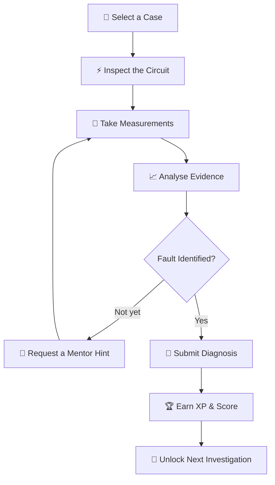

# 🔎 CIRCUIT SLEUTH

### The Electronics Detective

> **Every circuit has a secret. Find the fault. Prove it with measurements.**

\<p align="center">
&#x20; \<a href="[https://circuit-sleuth.embarko.app/](https://circuit-sleuth.embarko.app/)">
&#x20;   \
&#x20; \</a>
&#x20; \
&#x20; \
&#x20; \
\</p>

\<p align="center">
&#x20; \<strong>Don't guess the fault. Investigate it.\</strong>
\</p>

---

## 🌐 Experience CIRCUIT SLEUTH

[**▶ OPEN THE LIVE APPLICATION**](https://circuit-sleuth.embarko.app/)

CIRCUIT SLEUTH is an interactive electronics troubleshooting simulator that turns circuit diagnosis into a hands-on investigation experience.

Step into the role of an electronics detective. Examine circuits, take measurements, analyse waveforms, uncover hidden faults and prove your diagnosis using virtual instruments.

Instead of simply revealing the answer, CIRCUIT SLEUTH encourages you to think like an engineer.

---

## 🕵️ What Makes It Different?

Most learning experiences explain how circuits work.

**CIRCUIT SLEUTH challenges you to discover why they don't.**

You are given a faulty circuit. Your mission is to investigate it using measurements, understand its behaviour and identify the component or connection responsible for the fault.

### ⚡ Core Features

| Feature                   | Description                                                             |
| ------------------------- | ----------------------------------------------------------------------- |
| 🔬 21 Investigation Cases | Progress through increasingly challenging circuit scenarios.            |
| 🔧 Virtual Multimeter     | Investigate circuits using DC voltage, resistance and continuity modes. |
| 📈 Oscilloscope Lab       | Explore waveforms and analyse signal behaviour.                         |
| 🧠 Mentor System          | Receive progressive hints based on your investigation.                  |
| 🎯 Diagnosis Engine       | Use your measurements to identify the underlying fault.                 |
| 🏆 XP & Ranking           | Earn experience and progress through ranks.                             |
| ⭐ Scoring System          | Get rewarded for accurate diagnosis and efficient investigation.        |
| 📋 Leaderboard            | Track performance through the available leaderboard system.             |
| 💾 Progress Tracking      | Continue your investigation with saved progress.                        |
| 📱 Responsive Interface   | Investigate circuits across desktop and mobile screens.                 |

---

## 🎮 How to Play

\<details> \<summary>\<strong>01 — Start Your Investigation\</strong>\</summary>

Launch the application and enter the investigation workbench.

Choose an available case and inspect the circuit carefully.

\</details>

\<details> \<summary>\<strong>02 — Investigate the Circuit\</strong>\</summary>

Examine the circuit diagram and identify important test points.

Use the virtual multimeter to take measurements.

Available measurement modes:

- DC Voltage
- Resistance
- Continuity

\</details>

\<details>
\<summary>\<strong>03 — Analyse the Evidence\</strong>\</summary>

Compare your measurements with expected circuit behaviour.

Use the oscilloscope where applicable to inspect waveform characteristics.

Need guidance? Use the Mentor system to receive progressive hints.

\</details>

\<details>
\<summary>\<strong>04 — Identify the Fault\</strong>\</summary>

Use your collected evidence to determine the actual circuit fault.

Your diagnosis should be supported by measurements, not random guessing.

\</details>

\<details>
\<summary>\<strong>05 — Earn XP and Progress\</strong>\</summary>

Complete investigations, earn points and improve your rank.

Challenge yourself with increasingly difficult cases.

\</details>

---

## 🧪 Virtual Laboratory

### 1. Virtual Multimeter

A simulated digital multimeter for investigating circuit behaviour.

- DC voltage measurements.
- Resistance measurements.
- Continuity testing.
- Probe placement at circuit test points.
- Measurement history and inspection.

### 2. Bench Oscilloscope

Explore electrical signals through an interactive oscilloscope interface.

- Inspect waveform behaviour.
- Analyse signal characteristics.
- Understand circuit output.
- Use waveform evidence during investigations.

### 3. Intelligent Mentor

The Mentor provides progressive guidance to help players reason through a circuit.

Rather than immediately revealing the answer, it encourages evidence-based troubleshooting.

---

## 🧩 Investigation Journey



---

## 🛠️ Built With

| Technology            | Purpose                                    |
| --------------------- | ------------------------------------------ |
| HTML5                 | Application structure                      |
| CSS3                  | Styling, responsive layouts and animations |
| JavaScript            | Application logic and interactions         |
| JavaScript ES Modules | Modular application architecture           |
| SVG                   | Interactive circuit diagrams               |
| Canvas                | Oscilloscope visualisation                 |
| Local Storage         | Persistent local progress and settings     |
| Python HTTP Server    | Local development server                   |
| Embarko               | Public static application hosting          |

---

## 💻 Run Locally

Want to explore the source code or contribute?

### Prerequisites

- Git
- Python 3
- A modern web browser
- VS Code (recommended)

### 1. Clone the repository

```bash
git clone YOUR_GITHUB_REPOSITORY_URL
```

### 2. Open the project folder

```bash
cd FaultFinder
```

### 3. Start the local server

```bash
python -m http.server 8080
```

### 4. Open the application

Visit:

```text
http://localhost:8080/
```

### 5. Run automated verification

Visit:

```text
http://localhost:8080/?test=1
```

The verification interface runs the project's automated checks.

---

## 🏗️ Project Architecture

CIRCUIT SLEUTH uses a modular, browser-based architecture.

- **Presentation Layer:** HTML and CSS interfaces.
- **Interaction Layer:** JavaScript event handling and user interactions.
- **Simulation Layer:** Circuit behaviour and measurement logic.
- **Instrumentation Layer:** Virtual multimeter and oscilloscope.
- **Learning Layer:** Mentor, scoring and progression.
- **Persistence Layer:** Saved progress and leaderboard-related functionality.

The application is designed to run as a static website without requiring a conventional backend server for its core investigation experience.

---

## 🌍 Live Deployment

\<p align="center">
&#x20; \<a href="[https://circuit-sleuth.embarko.app/](https://circuit-sleuth.embarko.app/)">
&#x20;   \
&#x20; \</a>
\</p>

CIRCUIT SLEUTH is deployed as a static web application using **Embarko**.

**Live URL:** [https://circuit-sleuth.embarko.app/](https://circuit-sleuth.embarko.app/)

---

## 🎓 Embarko Student Challenge

Built as an AI-assisted application project for the Embarko Student Challenge.

The project explores how interactive simulation can make electronics troubleshooting more engaging, practical and accessible.

**Challenge hashtag:** `#DeployWithEmbarko`

---

## 💡 Why I Built This

Electronics students often learn circuit theory through equations, diagrams and textbooks. However, understanding how to diagnose a real circuit fault requires a different kind of thinking.

I wanted to create an experience where students could investigate circuit failures, experiment with virtual instruments, analyse evidence and develop systematic troubleshooting skills.

That idea became **CIRCUIT SLEUTH**.

---

## 🚀 Future Possibilities

Potential directions for future development:

- More advanced analogue and digital circuit investigations.
- Additional fault scenarios.
- More realistic instrument simulations.
- Expanded learning and assessment experiences.
- New interactive electronics laboratories.

---

## 👩‍💻 Project Creator

**RAJASRI S**

B.E. Mechatronics Engineering
Electronics | Robotics | Automation | Technology

---

\<p align="center">
&#x20; \<strong>Every circuit has a secret.\</strong>\<br/>
&#x20; \<em>Find the fault. Prove it with measurements.\</em>
\</p>

\<p align="center">
&#x20; 🔎 \<strong>CIRCUIT SLEUTH — The Electronics Detective\</strong>
\</p>

\<p align="center">
&#x20; \<a href="[https://circuit-sleuth.embarko.app/](https://circuit-sleuth.embarko.app/)">Launch App\</a>
&#x20; ·
&#x20; \<a href="#-how-to-play">How to Play\</a>
&#x20; ·
&#x20; \<a href="#-built-with">Technology\</a>
\</p>
